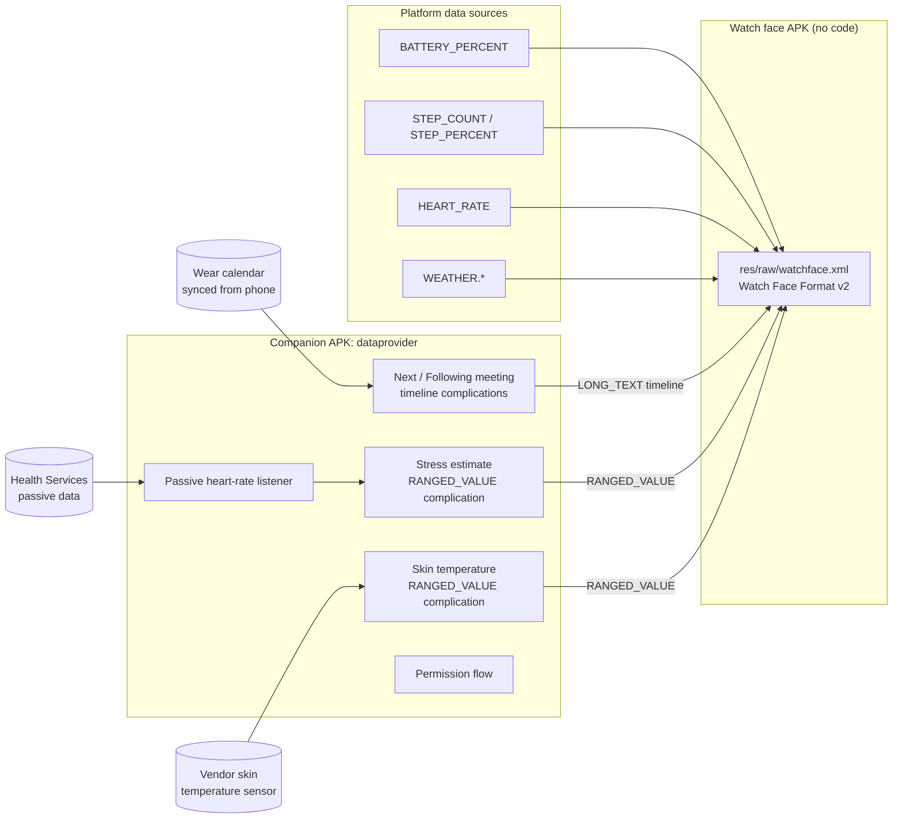

# Development

How Dashface is built, tested and changed. For what it does and how to use it, see the
[README](README.md).

## Architecture



| Module | What it is |
|---|---|
| `:watchface` | The WFF package: `android:hasCode="false"`, XML, small PNG icons, no font files (uses the system font). |
| `:dataprovider` | Kotlin complication data sources: `NextMeetingDataSourceService`, `SecondMeetingDataSourceService`, `StressDataSourceService`, `SkinTemperatureDataSourceService`, plus the permission screens. |
| `:wff-validator` | A small JVM tool that validates `watchface.xml` against the official WFF XSD (XSD 1.1, via Xerces). |
| `tools/generate_watchface.py` | Generates `watchface.xml`, the icons and preview SVGs from one geometry/color definition. |
| `tools/render_previews.js` | Renders the preview SVGs to PNG with Playwright. |

### Why some things are built the way they are

- **Corner swapping and complications.** WFF only allows `ComplicationSlot` at the top
  level of the scene, never inside a `ListConfiguration`. So each corner has its own stress
  slot, shaped to that corner's arc. It draws only when that corner is set to *Stress*.
  Battery, steps and heart rate come from built-in WFF data sources and are drawn by the scene.
  Only the bottom-left slot (the default stress corner) has a default provider. If you move
  Stress to another corner, pick a stress source for that corner's slot in the editor.
- **Morning / afternoon / night weather.** WFF exposes current weather, 8 hourly forecasts
  (`WEATHER.HOURS.1..8`) and daily forecasts. Each period uses current conditions while
  you're inside it (06–12, 12–18, 18–06). Otherwise it uses the hourly forecast for 09:00,
  15:00 or 21:00 when that is within 8 hours, and the daily day or night forecast after that.
- **Stress.** Wear OS has no public stress data type. On Galaxy watches, pick Samsung
  Health's stress complication if it's offered. Otherwise the companion app gives an
  **estimate** from passive heart rate: how far your current heart rate is above a slowly
  adapting resting baseline. It's a wellness hint, not a medical measurement, and exercise
  raises it too.
- **Skin temperature.** Neither WFF nor Health Services exposes skin temperature, and Android
  has no standard sensor type for it. Watches that measure it expose a vendor sensor, so the
  companion looks for a sensor whose name or string type contains both "skin" and "temp"
  (`SkinTemperature.isSkinTemperatureSensor`). Without one it returns `NO_DATA`, which matches
  no `<Complication>` in the slot, so the thermometer simply isn't drawn. Readings outside
  20–45 °C are dropped as noise, and a cached reading is shown for at most 2 h. The thermometer
  is a `RoundRectangle` whose `width` is transformed by the normalized ranged value. Its color
  comes from wrist-skin bands on the raw value in °C (`THERMO_BANDS` in the generator: blue
  below 32 °C, orange to 35.5 °C, red above), one `Condition` branch per band, so track, liquid
  and bulb switch color together. The bands assume °C, which the companion always sends; a
  third-party provider in another unit would get the wrong colors.

## Battery & performance

- **No code in the watch face.** The WFF runtime renders it. Time updates once a minute, with
  no seconds, animations or per-frame work.
- **Meetings never wake the app on a timer.** Each request returns a *timeline* of entries
  for the next 36 h, and the system switches between them when meetings start and end. The
  app runs only when:
  - the calendar syncs (`PROVIDER_CHANGED`),
  - the time, time zone or locale changes,
  - the hourly safety refresh fires. The system batches it and skips it while the screen is off.
- **Stress uses passive monitoring only.** It reuses heart-rate samples the watch already
  takes, in batches, and never turns sensors on by itself. Monitoring is registered only
  while a stress complication is on the active watch face, and removed when the last one goes.
  The face is asked to redraw only when the score changes by 3 points or more.
- **Skin temperature is a one-shot read.** `UPDATE_PERIOD_SECONDS = 900` (the platform
  minimum), which the system honors only while the face is visible. Each request registers a
  listener, takes the first plausible sample (5 s timeout) and unregisters.
- **Cheap colors.** Every bar, footprint and beat has a static color (or tint); only its
  `alpha` follows the value, with no color math at draw time. The stress bar picks one of four
  static colors through a `Condition`. A metric without `segments`, `trail` or `bands` falls
  back to a continuous arc with a static `SweepGradient`.
- **Segmented battery.** Battery (`segments=10` in the generator) is drawn as 10 short arcs,
  each with a static color from light (low) to darker (full). Bar *i* is shown when the level is
  above *i*/10 through an `alpha` transform, so 1–10 % lights the first bar. No knob.
- **Banded stress bar.** Stress (`STRESS_BANDS` in the generator) is one solid arc from the
  anchor to the value, with no track: the rest of the arc stays black. Its color comes from the
  level, for the whole bar: green up to 25, yellow up to 50, red up to 75, dark red above. One
  `Condition` branch per band, so only one arc is drawn, and the badge icon takes the same
  color. At 0 nothing is drawn (a round cap would leave a dot). The placeholder (no source yet)
  draws no bar, only `--`. In single color mode the bar is the accent, brighter as it fills.
- **Image trails for steps and heart rate.** A metric's `trail` is a row of small white
  images along its arc, tinted at runtime. Image *i* of *n* goes from dim to lit once the value
  is above *i*/*n*, through the same `alpha` transform as the battery bars.
  - Steps: 10 footprints (`ic_step_left` / `ic_step_right`) walking outward, alternating feet,
    rotated to the walking direction, pale to vivid green.
  - Heart rate: 8 heartbeat pieces (`ic_ecg_0..7`, `ECG_*` in the generator) laid along the
    arc with the spike toward the center, each taller than the last. The beat is symmetric so
    the same image works whichever way a corner's arc runs.
- **Ambient mode** keeps only the time, the date and a small battery bar (10 rounded bars and
  the percentage) in the first meeting row's place. Both meeting rows, the bezel bars, the
  weather, the thermometer and gradients are hidden. The battery bar is a top-level group with
  `alpha="0"` and an `AMBIENT` variant that brings it to 200, so it costs nothing while
  interactive.
- **Small assets.** Weather icons are 48 px, metric icons 24 px, and the images that can be
  on screen total well under 1 MB.

## Permissions

| Package | Permission | Why | When it's asked |
|---|---|---|---|
| watch face | `BODY_SENSORS` (≤ API 35) / `health.READ_HEART_RATE` (API 36+) | `[HEART_RATE]` | By the system when the face is selected |
| watch face | `ACTIVITY_RECOGNITION` | `[STEP_COUNT]` | By the system when the face is selected |
| dataprovider | `READ_CALENDAR` | Next meetings | Tap the "Tap to show meetings" row |
| dataprovider | `BODY_SENSORS` (≤ 35) / `health.READ_HEART_RATE` (36+) | Stress estimate | Tap the "Tap" stress bar |
| dataprovider | `BODY_SENSORS_BACKGROUND` (≤ 35) / `health.READ_HEALTH_DATA_IN_BACKGROUND` (36+) | Stress estimate updates while the screen is off | Asked as a separate, optional second step |
| dataprovider | `BODY_SENSORS` (≤ 35) / `health.READ_SKIN_TEMPERATURE` (36+) | Skin temperature | Tap the "Tap" thermometer (only on watches with the sensor) |
| dataprovider | `BODY_SENSORS_BACKGROUND` (≤ 35) / `health.READ_HEALTH_DATA_IN_BACKGROUND` (36+) | Skin temperature updates while the face shows | Optional second step |
| dataprovider | `RECEIVE_BOOT_COMPLETED` | Re-register the passive heart-rate listener after a reboot (only if stress is in use) | Install time |

Flow: a short rationale screen comes first, then the system dialog. If you choose "Don't
ask again", the button opens the app's settings page instead. While a permission is missing,
the matching row or bar shows a tappable "allow" state or a `--` placeholder. It never shows
stale values as current.

**Privacy:** neither app has internet access or analytics, and calendar and heart-rate data
never leave the watch.

## Build, install, test

Requirements: JDK 17+, Android SDK with platform 36. Python 3 + Pillow and Node + Playwright
are only needed to regenerate the XML or the previews.

```bash
./gradlew :watchface:check                      # WFF XSD validation + lint
./gradlew :dataprovider:testDebugUnitTest       # timeline, stress, skin temperature tests
./gradlew assembleDebug                         # both APKs

# Install both on a Wear OS 5+ watch or emulator (API 34+)
adb install -r dataprovider/build/outputs/apk/debug/dataprovider-debug.apk
adb install -r watchface/build/outputs/apk/debug/watchface-debug.apk
```

Then long-press the current watch face and choose **Dashface**. To debug WFF runtime errors:

```bash
adb logcat --pid=$(adb shell pidof -s com.google.wear.watchface.runtime)
```

Both APKs must be signed with the **same key** so the watch face can default to the
companion's complications (see `SAFE_WATCH_FACES` in the companion manifest). Release builds are
signed with the key named by the `KEYSTORE_FILE`, `KEYSTORE_PASSWORD`, `KEY_ALIAS` and
`KEY_PASSWORD` env vars, and fall back to the debug key when they're not set.

### Releases

Every push to `main` runs `.github/workflows/release.yml`. It validates and tests the commit,
builds both apps signed with the release key from repo secrets, and publishes a GitHub Release
`v1.0.<run number>` with:

- both APKs, to install directly with `adb`
- both App Bundles, for the Play Console
- the companion's R8 mapping file

If the `ANDROID_PUBLISHER_CREDENTIALS` secret is set, it also uploads both bundles to the Play
Console with [Gradle Play Publisher](https://github.com/Triple-T/gradle-play-publisher):
`./gradlew :watchface:publishReleaseBundle :dataprovider:publishReleaseBundle`, to the internal
track unless the `PLAY_TRACK` variable says otherwise.

The Play listings (text, icon, feature graphic, screenshots), the answers for the Play Console
forms, and the step-by-step submission guide are in [`store-listing/`](store-listing/SUBMISSION_GUIDE.md).
The privacy policy is [`PRIVACY_POLICY.md`](PRIVACY_POLICY.md).

### Changing the design

Edit `tools/generate_watchface.py` (geometry, colors, metrics, accents, presets), then:

```bash
python3 tools/generate_watchface.py
node tools/render_previews.js     # needs Playwright; updates docs/screenshots + picker preview
./gradlew :watchface:validateWatchFace
```

After a visual change, also refresh the Play graphics and the README video. The video is drawn
with the same preview renderer; its scenes, captions and timing are in
`tools/video/make_frames.py`, and the soundtrack is `tools/video/soundtrack.m4a`.

```bash
node store-listing/tools/render_store_assets.js
python3 tools/video/make_frames.py && node tools/video/render_video.js   # needs ffmpeg (libx264)
```

### Memory footprint (Play requirement)

Google's evaluator lives in [google/watchface](https://github.com/google/watchface)
(`play-validations/memory-footprint`). Build it there, then run:

```bash
java -jar memory-footprint.jar --watch-face watchface/build/outputs/apk/release/watchface-release.apk \
  --schema-version 2 --ambient-limit-mb 10 --active-limit-mb 100 --apply-v1-offload-limitations --estimate-optimization
```

## Verified vs. still to check on a device

Verified in this repo:

- `watchface.xml` validates against the official WFF v2 XSD.
- Expressions use only operators and functions in Google's WFF expression grammar.
- Both modules build, lint passes, and the unit tests pass. They cover meeting ordering,
  overlaps, in-progress meetings, midnight splits, DST changes, the stress estimator, and skin
  temperature sensor matching, formatting and freshness.

Not yet run on hardware (no emulator in the build environment). Please check:

1. **Sweep gradient angles.** The gradient must line up with the arc. Both use the WFF
   convention, 0° = 12 o'clock, clockwise.
2. **Reused configuration.** The face reuses the same `ListConfiguration` id (`color_mode`,
   `arc_*`) in several places, and the runtime must accept that.
3. **Default providers.** The face defaults to the companion's complications through
   `SAFE_WATCH_FACES`, which is set to the watch face package name. If they don't attach by
   default, pick them once in the editor.
4. **Permission names.** Check `READ_HEART_RATE`, `ACTIVITY_RECOGNITION` and the background
   variants against the current Wear OS 6 behavior-change docs.
5. **Skin temperature sensor.** Check that the watch's sensor is matched (`adb shell dumpsys
   sensorservice | grep -i temp`), that it reports °C in `values[0]`, and which permission
   it needs on Wear OS 6 (`health.READ_SKIN_TEMPERATURE` is assumed). Some vendors keep the
   sensor private to their own apps; then the thermometer stays hidden.
6. **Battery.** Leave the face on for an hour with the screen off, then check
   `adb shell dumpsys batterystats --charged org.neteinstein.dashface.provider` for zero
   wakeups from the companion.

See [`NOTICE.md`](NOTICE.md) for third-party assets.
