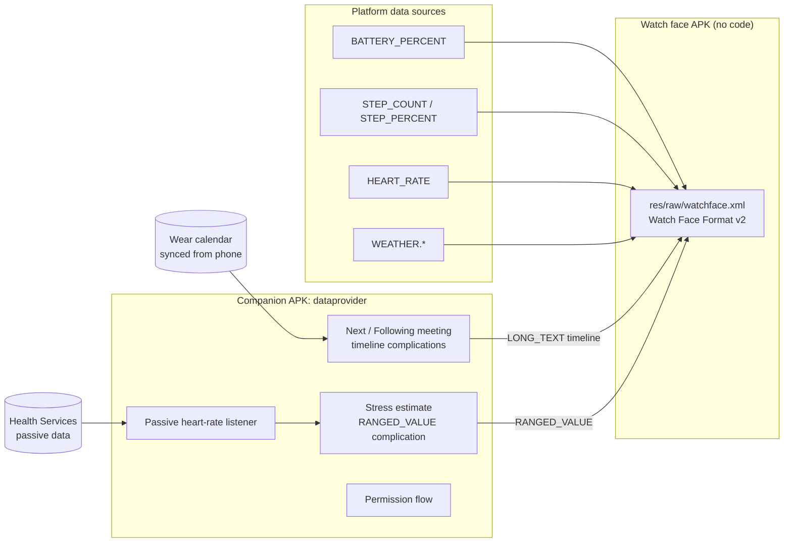

# Dashface

A battery-friendly Wear OS watch face built with **Watch Face Format (WFF)**. Four health
bars hug the bezel, and the center shows the weather for morning, afternoon and night, the
date, a large digital time, and your **next calendar meetings**.

| Default | Single color (amber) | Health on top | Ambient |
|---|---|---|---|
|  |  |  |  |

> The screenshots are rendered from the same geometry by `tools/generate_watchface.py`
> (desktop fonts, sample data). On a watch, the system font and live data are used.

The prompt this was built from is in [`docs/WATCHFACE_PROMPT.md`](docs/WATCHFACE_PROMPT.md).

## What it shows

| Area | Content | Color behavior |
|---|---|---|
| Top-left bar | Battery | Dim blue when low → vivid cyan when full |
| Top-right bar | Steps (toward your step goal) | Red → yellow → green as it fills |
| Bottom-left bar | Stress (complication) | Green → yellow → red |
| Bottom-right bar | Heart rate (40–180 bpm) | Calm red → urgent red |
| Top row | Weather icon + temperature for **Morning · Afternoon · Night** | – |
| Under it | `THU 12` (weekday in accent color) | – |
| Center | `HH:mm`, follows the 12/24 h system setting | – |
| Under the time | Next meeting and the one after it (`10:30  Team standup`; `Now` while it runs; `No more meetings today`) | Time in accent color |

Top bars grow outward from 12 o'clock and bottom bars from 6 o'clock. Each bar has a dim
track, a gradient fill, a white knob at the tip, and an icon + value badge near its end. The
badge icon takes the color of the bar's current range.

## Customization (long-press the face → Customize)

- **Bar positions**: pick Battery / Steps / Stress / Heart rate for each corner. Presets:
  *Classic*, *Mirrored*, *Health on top*.
- **Color mode**: *Multicolor* (per-metric gradients) or *Single color*. Single color uses
  one accent (cyan, white, green, amber, purple), and the bar's brightness follows its value.
  The accent also colors the weekday and meeting times.
- **Show weather**: on/off.
- **Meetings shown**: next meeting only, or next two.
- **Complications**: the meeting rows and the stress source accept any compatible
  provider. The meeting rows fall back to the system's *Next event* if the companion app isn't
  installed.

## Architecture



| Module | What it is |
|---|---|
| `:watchface` | The WFF package: `android:hasCode="false"`, XML, small PNG icons, no font files (uses the system font). |
| `:dataprovider` | Kotlin complication data sources: `NextMeetingDataSourceService`, `SecondMeetingDataSourceService`, `StressDataSourceService`, plus the permission screens. |
| `:wff-validator` | A small JVM tool that validates `watchface.xml` against the official WFF XSD (XSD 1.1, via Xerces). |
| `tools/generate_watchface.py` | Generates `watchface.xml`, the icons and preview SVGs from one geometry/color definition. |
| `tools/render_previews.js` | Renders the preview SVGs to PNG with Playwright. |

### Why some things are built the way they are

- **Corner swapping and complications.** WFF only allows `ComplicationSlot` at the top
  level of the scene, never inside a `ListConfiguration`. So each corner has its own stress
  slot, shaped to that corner's arc. It draws only when that corner is set to *Stress*.
  Battery, steps and heart rate come from built-in WFF data sources and are drawn by the scene.
  Only the bottom-left slot (the default stress corner) has a default provider. If you move
  Stress to another corner, pick a stress source for that corner's slot in the editor.
- **Morning / afternoon / night weather.** WFF exposes current weather, 8 hourly forecasts
  (`WEATHER.HOURS.1..8`) and daily forecasts. Each period uses current conditions while
  you're inside it (06–12, 12–18, 18–06). Otherwise it uses the hourly forecast for 09:00,
  15:00 or 21:00 when that is within 8 hours, and the daily day or night forecast after that.
- **Stress.** Wear OS has no public stress data type. On Galaxy watches, pick Samsung
  Health's stress complication if it's offered. Otherwise the companion app gives an
  **estimate** from passive heart rate: how far your current heart rate is above a slowly
  adapting resting baseline. It's a wellness hint, not a medical measurement, and exercise
  raises it too.

## Battery & performance

- **No code in the watch face.** The WFF runtime renders it. Time updates once a minute, with
  no seconds, animations or per-frame work.
- **Meetings never wake the app on a timer.** Each request returns a *timeline* of entries
  for the next 36 h, and the system switches between them when meetings start and end. The
  app runs only when:
  - the calendar syncs (`PROVIDER_CHANGED`),
  - the time, time zone or locale changes,
  - the hourly safety refresh fires. The system batches it and skips it while the screen is off.
- **Stress uses passive monitoring only.** It reuses heart-rate samples the watch already
  takes, in batches, and never turns sensors on by itself. Monitoring is registered only
  while a stress complication is on the active watch face, and removed when the last one goes.
  The face is asked to redraw only when the score changes by 3 points or more.
- **Cheap colors.** The fading colors are a static `SweepGradient` across the whole arc. The
  fill's sweep follows the value, so the color at the tip reflects it, with no color math at
  draw time. In single-color mode only the fill's alpha changes.
- **Ambient mode** keeps only the time, date and next meeting. All bars, the weather and
  gradients are hidden.
- **Small assets.** Weather icons are 48 px, metric icons 24 px, and the images that can be
  on screen total well under 1 MB.

## Permissions

| Package | Permission | Why | When it's asked |
|---|---|---|---|
| watch face | `BODY_SENSORS` (≤ API 35) / `health.READ_HEART_RATE` (API 36+) | `[HEART_RATE]` | By the system when the face is selected |
| watch face | `ACTIVITY_RECOGNITION` | `[STEP_COUNT]` | By the system when the face is selected |
| dataprovider | `READ_CALENDAR` | Next meetings | Tap the "Tap to show meetings" row |
| dataprovider | `BODY_SENSORS` (≤ 35) / `health.READ_HEART_RATE` (36+) | Stress estimate | Tap the "Tap" stress bar |
| dataprovider | `BODY_SENSORS_BACKGROUND` (≤ 35) / `health.READ_HEALTH_DATA_IN_BACKGROUND` (36+) | Stress estimate updates while the screen is off | Asked as a separate, optional second step |
| dataprovider | `RECEIVE_BOOT_COMPLETED` | Re-register the passive heart-rate listener after a reboot (only if stress is in use) | Install time |

Flow: a short rationale screen comes first, then the system dialog. If you choose "Don't
ask again", the button opens the app's settings page instead. While a permission is missing,
the matching row or bar shows a tappable "allow" state or a `--` placeholder. It never shows
stale values as current.

**Privacy:** neither app has internet access or analytics, and calendar and heart-rate data
never leave the watch.

## Build, install, test

Requirements: JDK 17+, Android SDK with platform 36. Python 3 + Pillow and Node + Playwright
are only needed to regenerate the XML or the previews.

```bash
./gradlew :watchface:check                      # WFF XSD validation + lint
./gradlew :dataprovider:testDebugUnitTest       # timeline + stress estimator tests
./gradlew assembleDebug                         # both APKs

# Install both on a Wear OS 5+ watch or emulator (API 34+)
adb install -r dataprovider/build/outputs/apk/debug/dataprovider-debug.apk
adb install -r watchface/build/outputs/apk/debug/watchface-debug.apk
```

Then long-press the current watch face and choose **Dashface**. To debug WFF runtime errors:

```bash
adb logcat --pid=$(adb shell pidof -s com.google.wear.watchface.runtime)
```

Both APKs must be signed with the **same key** so the watch face can default to the
companion's complications (see `SAFE_WATCH_FACES` in the companion manifest). Replace the
debug signing configs before publishing.

### Changing the design

Edit `tools/generate_watchface.py` (geometry, colors, metrics, accents, presets), then:

```bash
python3 tools/generate_watchface.py
node tools/render_previews.js     # needs Playwright; updates docs/screenshots + picker preview
./gradlew :watchface:validateWatchFace
```

### Memory footprint (Play requirement)

Google's evaluator lives in [google/watchface](https://github.com/google/watchface)
(`play-validations/memory-footprint`). Build it there, then run:

```bash
java -jar memory-footprint.jar --watch-face watchface/build/outputs/apk/release/watchface-release.apk \
  --schema-version 2 --ambient-limit-mb 10 --active-limit-mb 100 --apply-v1-offload-limitations --estimate-optimization
```

## Verified vs. still to check on a device

Verified in this repo:

- `watchface.xml` validates against the official WFF v2 XSD.
- Expressions use only operators and functions in Google's WFF expression grammar.
- Both modules build (debug and release), lint passes, and 15 unit tests pass. They cover
  meeting ordering, overlaps, in-progress meetings, midnight splits, DST changes and the
  stress estimator.

Not yet run on hardware (no emulator in the build environment). Please check:

1. **Sweep gradient angles.** The gradient must line up with the arc. Both use the WFF
   convention, 0° = 12 o'clock, clockwise.
2. **Reused configuration.** The face reuses the same `ListConfiguration` id (`color_mode`,
   `arc_*`) in several places, and the runtime must accept that.
3. **Default providers.** The face defaults to the companion's complications through
   `SAFE_WATCH_FACES`, which is set to the watch face package name. If they don't attach by
   default, pick them once in the editor.
4. **Permission names.** Check `READ_HEART_RATE`, `ACTIVITY_RECOGNITION` and the background
   variants against the current Wear OS 6 behavior-change docs.
5. **Battery.** Leave the face on for an hour with the screen off, then check
   `adb shell dumpsys batterystats --charged com.neteinstein.dashface.provider` for zero
   wakeups from the companion.

See [`NOTICE.md`](NOTICE.md) for third-party assets.
