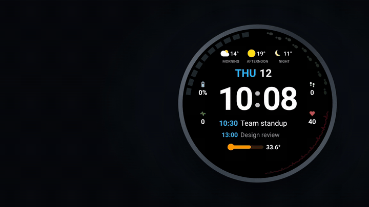
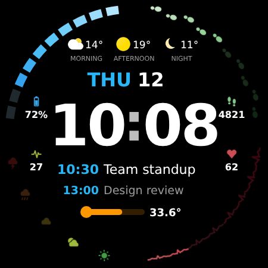
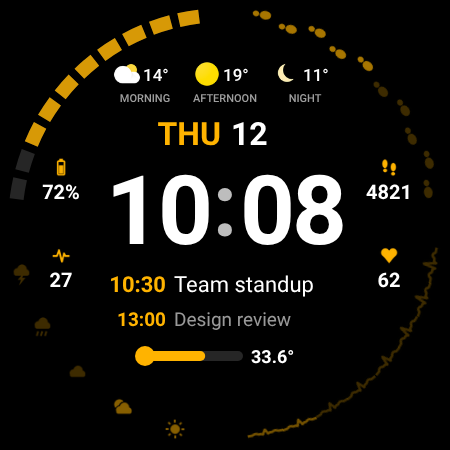
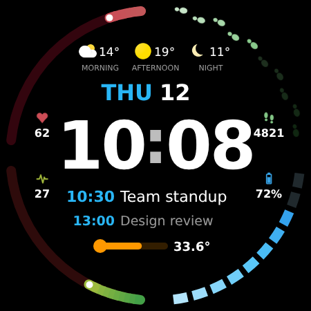
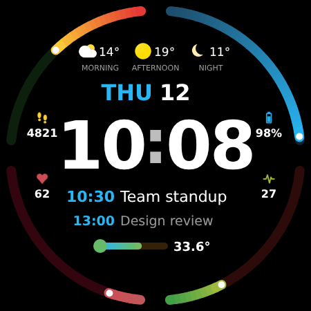
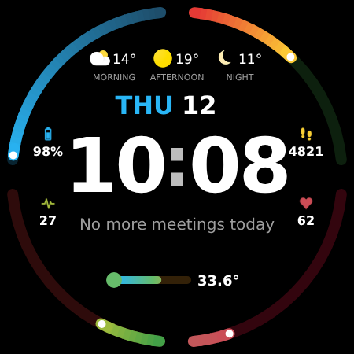
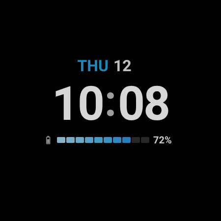

Plays on its own, without sound. <a href="docs/video/dashface.mp4">Watch with sound (MP4)</a>.

# Dashface

**Your day at a glance, on your wrist.**

A battery-friendly Wear OS watch face. Battery, steps, stress and heart rate hug the bezel.
The center shows the weather for the rest of the day, the time, your **next meetings**, and
your **skin temperature** on watches that measure it.

---

## A look around

<table>
<tr>
<td width="33%" align="center" valign="top">
 
<b>Multicolor.</b> Each bar fades through its own colors as it fills.
</td>
<td width="33%" align="center" valign="top">
 
<b>Single color.</b> One accent everywhere; a bar gets brighter as it fills.
</td>
<td width="33%" align="center" valign="top">
 
<b>Health on top.</b> Put any metric in any corner.
</td>
</tr>
<tr>
<td width="33%" align="center" valign="top">
 
<b>Mirrored.</b> One of three ready-made layouts.
</td>
<td width="33%" align="center" valign="top">
 
<b>Free afternoon.</b> When the calendar is clear, it says so.
</td>
<td width="33%" align="center" valign="top">
 
<b>Ambient.</b> Just the date, time and how much battery is left.
</td>
</tr>
</table>

Previews use sample data and desktop fonts. On the watch you see your own data in the system font.

## What it shows

| Where | What | Colors |
|---|---|---|
| 🔋 Top-left bar | Battery, as 10 bars that light up as it charges | Light blue for the low bars → darker blue for the full ones |
| 👣 Top-right footprints | Steps toward your daily goal | A trail of 10 footprints; one lights up per 10 % of the goal |
| ⛈️ Bottom-left weather | Stress, as 5 icons from sun to thunderstorm that light up as it rises | Green → yellow → red |
| ❤️ Bottom-right heartbeat | Heart rate (40–180 bpm), as a heart-monitor line whose spikes grow taller along the arc | Calm red → urgent red |
| ⛅ Top row | Weather icon and temperature for **morning · afternoon · night** | – |
| 📅 Under it | Weekday and day, `THU 12` | Weekday in your accent color |
| 🕙 Center | The time, in 12 or 24 h like your watch | – |
| 🗓️ Under the time | Your next meeting and the one after it: `10:30  Team standup`, `Now` while it runs, or *No more meetings today* | Time in your accent color |
| 🔋 Ambient only | In place of the meetings: a battery bar and the percentage | Light → darker blue |
| 🌡️ At the bottom | **Skin temperature** as a thermometer, e.g. `33.6°` | Cool blue → warm orange → red, by wrist temperature |

Each continuous bar has a white dot at its tip and a small icon with the value next to it. The icon takes
the color of the bar.

### Skin temperature

The thermometer appears only on watches with a **skin temperature sensor**. On other watches
nothing is drawn there. It shows °C or °F, following your watch's settings. The bar grows
from 28 to 38 °C (82–100 °F), and the whole thermometer changes color with the reading:

| Color | Wrist skin temperature | What it usually means |
|---|---|---|
| 🔵 Cool blue | below 32 °C (89.6 °F) | Cooler than usual: a cold room, or less blood flow to the hands |
| 🟠 Warm orange | 32–35.5 °C (89.6–95.9 °F) | The usual range for wrist skin under a watch strap |
| 🔴 Red | 35.5 °C (95.9 °F) and up | Above the usual wrist range: heat, exercise, or possibly a fever |

These are wrist benchmarks, not body temperature. Wrist skin runs several degrees below your
core temperature (about 37 °C / 98.6 °F), so a fever shows up there as a smaller rise.

It's a wellness hint, not a medical measurement: wrist skin changes with the room, exercise and how tight the strap is. The first time, tap the thermometer
(it says **Tap**) to allow access to the sensor.

### Stress

Wear OS has no built-in stress reading. On Galaxy watches, you can pick Samsung Health's stress
complication if it's offered. Otherwise Dashface's companion app gives an **estimate** from your
heart rate: how far it is above your usual resting rate. Exercise raises it too.

## Make it yours

Long-press the watch face, then tap **Customize**.

- **Bar positions.** Pick Battery, Steps, Stress or Heart rate for each corner, or a preset:
  *Classic*, *Mirrored*, *Health on top*.
- **Color mode.** *Multicolor* or *Single color*, with five accents: cyan, white, green, amber
  and purple. The accent also colors the weekday, meeting times and the thermometer.
- **Show weather.** On or off.
- **Meetings shown.** Just the next meeting, or the next two.
- **Complications.** The meeting rows, the stress bar and the thermometer accept other
  compatible apps' data. Set the thermometer to *Empty* to hide it.

## Install

Dashface is two small apps that go on your watch:

1. **Dashface** – the watch face itself.
2. **Dashface data** – a companion that provides your meetings, the stress estimate and skin
   temperature. Without it, the meeting rows fall back to the watch's own *Next event*, and the
   stress bar and thermometer stay empty.

Install both on a Wear OS 5 or later watch. Each [GitHub Release](https://github.com/neteinstein/Dashface/releases)
has both signed APKs, ready for `adb install`. See [Development](Development.md) to build them
yourself. Then long-press your current watch face and choose **Dashface**.

### First run

Dashface asks only for what it uses, and only when you tap:

| To show | Dashface needs | How you're asked |
|---|---|---|
| Heart rate and steps | Body sensors, physical activity | By the watch when you pick the face |
| Your meetings | Calendar | Tap **Tap to show meetings** under the time |
| Stress | Heart rate (and, optionally, in the background) | Tap the stress bar while it says **Tap** |
| Skin temperature | Skin temperature sensor (and, optionally, in the background) | Tap the thermometer while it says **Tap** |

A short explanation comes before each system prompt. If you choose *Don't ask again*, the button
opens the app's settings instead. You can also open **Dashface data** from the app list to see
and grant everything in one place.

## Privacy

- **No internet access and no analytics.** Neither app can connect to the internet.
- Your calendar, heart rate and temperature **never leave the watch**.
- Missing access shows a tappable *allow* state or `--`, never old values passed off as current.

## Battery

Dashface is built to sip power:

- The face has **no code** of its own; the watch draws it. The time updates once a minute.
- **Meetings never wake the watch on a timer.** The companion hands over the whole day at once,
  and the watch switches rows when meetings start and end.
- **Stress reuses heart-rate readings the watch already takes**, and only while stress is on
  your face.
- **Skin temperature takes one quick reading every 15 minutes at most**, only while the face is
  showing, and lets go of the sensor right away.
- **Ambient mode** shows only the date, time and a small battery bar. The bezel bars, weather,
  meetings and thermometer are hidden.

## Common questions

**The thermometer doesn't show.** Your watch probably has no skin temperature sensor, or it hasn't
given a reading in the last two hours (for example, the watch is off your wrist). Check that
**Dashface data** is installed and that the thermometer slot isn't set to *Empty*.

**I moved Stress to another corner and it shows `--`.** Each corner has its own stress source.
In **Customize**, pick a stress source for the new corner.

**My meetings don't show.** Tap the meeting row to allow calendar access. Meetings come from the
calendar synced to your watch from your phone.

**The weather is missing.** Weather comes from your watch's own weather service. Open the
watch's weather app once and check that it has a location.

## Learn more

- [Development](Development.md): how it's built, tests, design tools and what still needs
  checking on a real watch.
- [The original prompt](docs/WATCHFACE_PROMPT.md) the watch face was built from.
- [Third-party material](NOTICE.md): the weather icons and the Watch Face Format schema.
- [Privacy policy](PRIVACY_POLICY.md) and [publishing on Google Play](store-listing/SUBMISSION_GUIDE.md).
